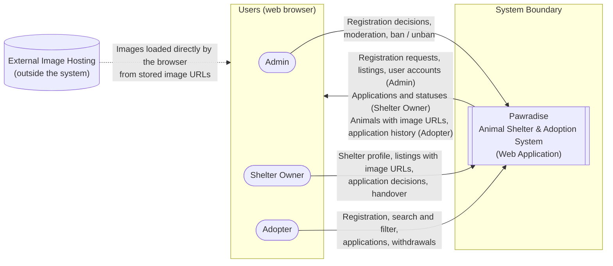

# Pawradise – System Vision and Boundary

| Item | Value |
|------|-------|
| Project | Pawradise – Animal Shelter & Adoption System |
| Course | SENG 321 – Software Engineering |
| Sprint | Sprint 1 (November 2026) |
| Document Owner | Software Architect |
| Status | Draft – pending team review |
| Source of Truth | Official Requirements Reference – Sprint 1 (FR-01 – FR-21, NFR-01 – NFR-09, BR-01 – BR-09) |

> This document describes the vision and boundary of the system. It does not add, remove, or change any requirement. All requirement IDs refer to the Official Requirements Reference.

---

## 1. Project Vision

> For animal shelters that need to find suitable homes for their animals and for people who want to adopt an animal, Pawradise (Animal Shelter & Adoption System) provides current animal listings, a consistent rule-based adoption process, and traceable status records. The first release supports web users and exposes an API contract for implementation and testing.

In short, the system aims to provide a single, trustworthy web platform where approved animal shelters can publish animals available for adoption and where adopters can find an animal and apply for it through a transparent, rule-based adoption process. Every adoption decision and status change is traceable.

## 2. Project Purpose

The system connects animal shelters with people who want to adopt animals. It aims to:

- Give shelter owners one place to publish animal listings and manage adoption applications.
- Let adopters browse, search, and filter available animals and apply for adoption online.
- Enforce adoption rules consistently (single approval, required documents, apartment permission, adoption limit, banned users).
- Let administrators keep the platform safe by reviewing shelter registrations, moderating listings, and banning users.
- Keep a complete, timestamped history of application and animal status changes.

## 3. Target Users

The system has exactly **three** user roles. There is no Volunteer role.

| Role | Description | Main Goals | Related FRs |
|------|-------------|------------|-------------|
| Admin | Platform administrator | Review and approve or reject shelter registrations, moderate inappropriate listings, ban or unban users | FR-03, FR-04, FR-05, FR-06 |
| Shelter Owner | Person who manages an animal shelter | Maintain the shelter profile, manage animal listings, review applications, record handovers | FR-07 – FR-12 |
| Adopter | Person who wants to adopt an animal | Find animals, submit and track adoption applications | FR-13 – FR-18 |

All roles can log in and log out (FR-01) and are restricted by FR-02 (role-based access control). Public registration is available only for Adopters and Shelter Owners; Admin accounts are not created through public registration (see A-03).

## 4. System Responsibilities

The system is responsible for:

1. **Identity and access** – Registering users, authenticating them, and allowing each role to use only its permitted functions (FR-01, FR-02, NFR-02, NFR-03).
2. **Shelter onboarding** – Receiving shelter registration requests and recording the admin decision (FR-03, FR-04).
3. **Listing management** – Storing animal listings with information and image URLs and managing their lifecycle without permanent deletion (FR-05, FR-08, FR-09).
4. **Animal discovery** – Showing available animals and supporting search and filtering by species and age (FR-13, FR-14, FR-15).
5. **Application processing** – Accepting adoption applications with the required information and documents, and processing approval, rejection, and withdrawal (FR-10, FR-11, FR-16, FR-17, FR-18).
6. **Rule enforcement** – Enforcing the applicable business rules for each operation and state transition (FR-19, FR-20, BR-01 – BR-08).
7. **Concurrency control** – Making sure only one approval succeeds for an animal when requests arrive at the same time, and returning HTTP 409 Conflict for the failed request (NFR-08, Scenario 3).
8. **Handover recording** – Moving an animal from Reserved to Adopted only after the shelter owner records the completed handover, and updating ownership information (FR-12, BR-04).
9. **Audit trail** – Recording every application and animal status change with the responsible user ID, previous status, new status, and timestamp (FR-21, NFR-09, BR-09).
10. **User feedback** – Returning clear error and success messages and consistent API error bodies (NFR-05, API Error Handling Reference).

## 5. Core Functionalities

### 5.1 Authentication and Authorization
- Register (Adopter and Shelter Owner), log in, and log out (FR-01). Admins log in with accounts that are not created through public registration (A-03).
- Role-based access control for Admin, Shelter Owner, and Adopter (FR-02).

### 5.2 Admin
- View shelter registration requests (FR-03).
- Approve or reject shelter registration requests (FR-04).
- Remove or archive inappropriate animal listings (FR-05).
- Ban or unban users (FR-06).

### 5.3 Shelter Owner
- Create and update the shelter profile (FR-07).
- Add animal listings with image URLs and animal information (FR-08).
- Update or archive animal listings (FR-09).
- View adoption applications (FR-10).
- Approve or reject adoption applications (FR-11).
- Mark an approved animal as adopted after handover (FR-12).

### 5.4 Adopter
- View available animals (FR-13).
- Search and filter by species and age (FR-14).
- View detailed animal information (FR-15).
- Submit adoption applications with required information and documents (FR-16).
- View application statuses and history (FR-17).
- Withdraw pending applications (FR-18).

### 5.5 Application and Status Management
- Automatically reject other pending applications when one is approved (FR-19, BR-02).
- Prevent approval when eligibility requirements are not met (FR-20, BR-05, BR-06, BR-08; see Section 5.7).
- Automatically reject the Pending applications of an adopter who is banned (BR-07, see Section 5.7).
- Maintain the history of application and animal status changes (FR-21, BR-09).

### 5.6 Status Models

**Animal statuses:** Available, Reserved, Adopted, Archived

| From | To | Trigger |
|------|----|---------|
| Available | Reserved | An application for the animal is approved |
| Reserved | Adopted | Shelter owner records the completed handover |
| Available | Archived | Shelter owner or admin archives the listing |

**Application statuses:** Pending, Approved, Rejected, Withdrawn

| From | To | Trigger |
|------|----|---------|
| Pending | Approved | Shelter owner approves (all rules satisfied) |
| Pending | Rejected | Shelter owner rejects; automatic rejection after another application for the same animal is approved (BR-02); or automatic rejection when the adopter is banned (BR-07, Section 5.7) |
| Pending | Withdrawn | Adopter withdraws the application |

Approved, Rejected, and Withdrawn are final for withdrawal purposes (BR-03, Scenario 4).

### 5.7 Team Clarifications of Business Rules (Sprint 1)

The team agreed on the following clarifications during Sprint 1. They clarify how BR-07 and BR-08 are applied; the official requirement IDs and the wording in the Official Requirements Reference are unchanged.

| Rule | Team Decision | Effect |
|------|---------------|--------|
| BR-07 – Banned User Rule | When an adopter is banned, all of their Pending adoption applications are automatically rejected. Previously Approved applications remain unchanged. | The ban and the automatic rejections run in the same database transaction, and every rejection is recorded in the status history (BR-09). A banned adopter cannot submit new applications (403). |
| BR-08 – Adoption Limit Rule | An adopter shall not have more than three animals in total with Reserved or Adopted status at the same time. Animals with Available or Archived status do not count toward this limit. | The limit is checked during application approval. If the approval would exceed the limit, the API returns 422 Unprocessable Content. The limit must also hold for concurrent approvals. |

These decisions close OI-02 and OI-03 (Section 11).

## 6. System Context Diagram

The diagram treats the system as a single black box and shows the actors that interact with it. The system only stores image URLs; it does not upload, download, or host images. The users' browsers load the images directly from the external host.

### 6.1 External Interactions

| External Entity | Type | Interaction with the System (information and purpose) | Trust Assumption |
|-----------------|------|--------------------------------------------------------|------------------|
| Admin | Human actor | Reviews shelter registrations, moderates listings, bans or unbans users through the web interface | Authenticated; has Admin role permissions only |
| Shelter Owner | Human actor | Manages the shelter profile, animal listings, adoption applications, and handover records through the web interface | Authenticated; can act only on their own shelter's data |
| Adopter | Human actor | Registers, browses and filters animals, submits, tracks, and withdraws adoption applications through the web interface | Authenticated for applications; can access only their own applications |
| Web Browser | Client platform | All actors access the system through commonly used web browsers on desktop, tablet, and mobile devices (NFR-06, NFR-07) | Untrusted client; all rules are enforced on the server side |
| External Image Hosting | External resource | The system stores image URLs and the browser loads the images from their original location. The system does not upload or host image files. | Not controlled by the system; an image may become unavailable |

No other external systems (payment, messaging, maps, social media, analytics) are integrated, as they are out of scope.

## 7. In-Scope Features

- Login and logout for all three roles; public registration for Adopters and Shelter Owners (FR-01, A-03).
- Role-based access control (FR-02, NFR-03).
- Shelter registration review and approval or rejection by the admin (FR-03, FR-04).
- Moderation of inappropriate animal listings (FR-05).
- Banning and unbanning users (FR-06).
- Shelter profile creation and update (FR-07).
- Animal listing creation, update, and archiving with image URLs (FR-08, FR-09).
- Browsing, searching, and filtering animals by species and age (FR-13, FR-14, FR-15).
- Adoption application submission with required information and documents (FR-16).
- Application review, approval, rejection, and withdrawal (FR-10, FR-11, FR-18).
- Automatic rejection of other pending applications after an approval (FR-19).
- Eligibility checks before approval (FR-20).
- Handover recording and transition to Adopted (FR-12).
- Application status tracking and history for adopters (FR-17).
- Status history and audit records (FR-21, NFR-09).
- Responsive web interface for desktop, tablet, and mobile browsers (NFR-06, NFR-07).

## 8. Out-of-Scope Features

The following features are **not** part of the initial project:

- Live chat
- Online payment
- AI-based animal recommendations
- GPS tracking
- Mobile application
- Social media integration
- Advanced analytics
- Direct image file uploads (images are represented by image URLs)

## 9. Constraints

| ID | Constraint |
|----|------------|
| C-01 | The system is delivered as a web application. A native mobile application is out of scope. |
| C-02 | The system has exactly three roles: Admin, Shelter Owner, Adopter. |
| C-03 | Animal images are stored as image URLs. Direct file upload is not implemented. |
| C-04 | Animal listings are archived instead of permanently deleted. |
| C-05 | Passwords must be stored using secure hashing algorithms (NFR-02). |
| C-06 | Standard pages must load within 3 seconds under normal conditions (NFR-01). |
| C-07 | The interface must work on commonly used browsers and be responsive (NFR-06, NFR-07). |
| C-08 | Concurrent approvals for the same animal must keep data consistent using database transactions; the losing request returns HTTP 409 (NFR-08). |
| C-09 | Every status change must be recorded with user ID, previous status, new status, and timestamp (BR-09, NFR-09). |
| C-10 | The API must use the agreed HTTP status codes and a consistent error body (`status`, `error`, `message`). |
| C-11 | All repository documentation is written in English. |
| C-12 | Development follows Git-Flow (`main`, `develop`, feature branches) and Issue → Feature Branch → Pull Request → Review → Merge. Direct pushes to `main` and `develop` are prohibited. Feature branches follow `feature/<issue>-<short-name>`, and the Sprint 1 release is tagged `sprint-1`. |
| C-13 | Sprint 1 deliverables must be submitted by November 5, 2026, 23:59. |

## 10. Assumptions

These assumptions do not change any requirement. Items marked **(to be confirmed)** need team agreement.

| ID | Assumption |
|----|------------|
| A-01 | Users access the system through a modern web browser with an internet connection. |
| A-02 | Image URLs point to images hosted outside the system. The system stores and displays the URL but does not host image files. |
| A-03 | Admin accounts are created by the team (for example, seeded) and are not created through public registration. **(to be confirmed)** |
| A-04 | A shelter owner can publish animal listings only after the admin approves the shelter registration (FR-03, FR-04). **(to be confirmed)** |
| A-05 | The adopter states whether they live in an apartment, so the system can apply BR-06. **(to be confirmed: stored in the user profile or in each application)** |
| A-06 | Because direct file uploads are out of scope, required documents are submitted as document links or references. **(to be confirmed)** |
| A-07 | For automatic rejections (BR-02), the status history records the shelter owner who approved the winning application as the responsible user. **(to be confirmed)** |
| A-08 | Status history records cannot be edited or deleted. |
| A-09 | "Eligibility requirements" in FR-20 means BR-05 (required documents), BR-06 (apartment permission), and BR-08 (adoption limit, Section 5.7). BR-07 is enforced when an application is submitted; because the Pending applications of a banned adopter are automatically rejected (Section 5.7), such applications can no longer be approved. **(to be confirmed)** |

## 11. Open Issues for Team Discussion

According to the consistency rules, these points are reported to the team. Open issues are **not** resolved in this document; closed issues show the team decision.

| ID | Issue | Related Items | Status |
|----|-------|---------------|--------|
| OI-01 | There is no transition out of Reserved if a handover does not happen, so the animal can stay Reserved forever. | Animal status transitions, BR-04 | Open |
| OI-02 | It was not defined whether Reserved animals (approved, not yet handed over) count toward the limit of three. | BR-08, Scenario 6 | **Closed** – Reserved animals count toward the three-animal limit (Section 5.7). |
| OI-03 | It was not defined what happens to the pending applications of a user who gets banned. | BR-07, FR-06, FR-20 | **Closed** – Pending applications are automatically rejected when an adopter is banned (Section 5.7). |
| OI-04 | The statuses of a shelter registration request (for example Pending, Approved, Rejected) are not defined. | FR-03, FR-04 | Open |
| OI-05 | It is not defined which species the system supports. BR-06 mentions only dogs and cats. | FR-14, BR-06 | Open |
| OI-06 | FR-05 says "remove or archive", but listings are archived instead of permanently deleted. The meaning of "remove" needs to be clarified. | FR-05, C-04 | Open |
| OI-07 | The list of mandatory documents is not defined. Only the apartment permission document (BR-06) is named. | FR-16, BR-05 | Open |

### 11.1 Additional Open Issues (Pending Team Discussion)

These topics were raised in the Project Proposal. They are not requirements and will be evaluated in a later sprint:

- Whether external document links should be validated by file type (for example PDF) or accept any valid HTTPS URL.
- Whether a Reserved animal should automatically return to Available after a timeout if the handover is delayed.
- Whether one user account can manage more than one shelter.
