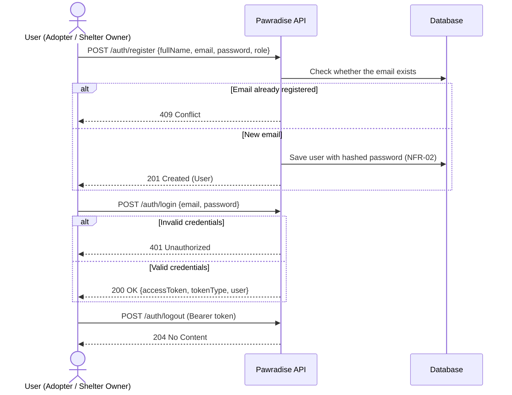
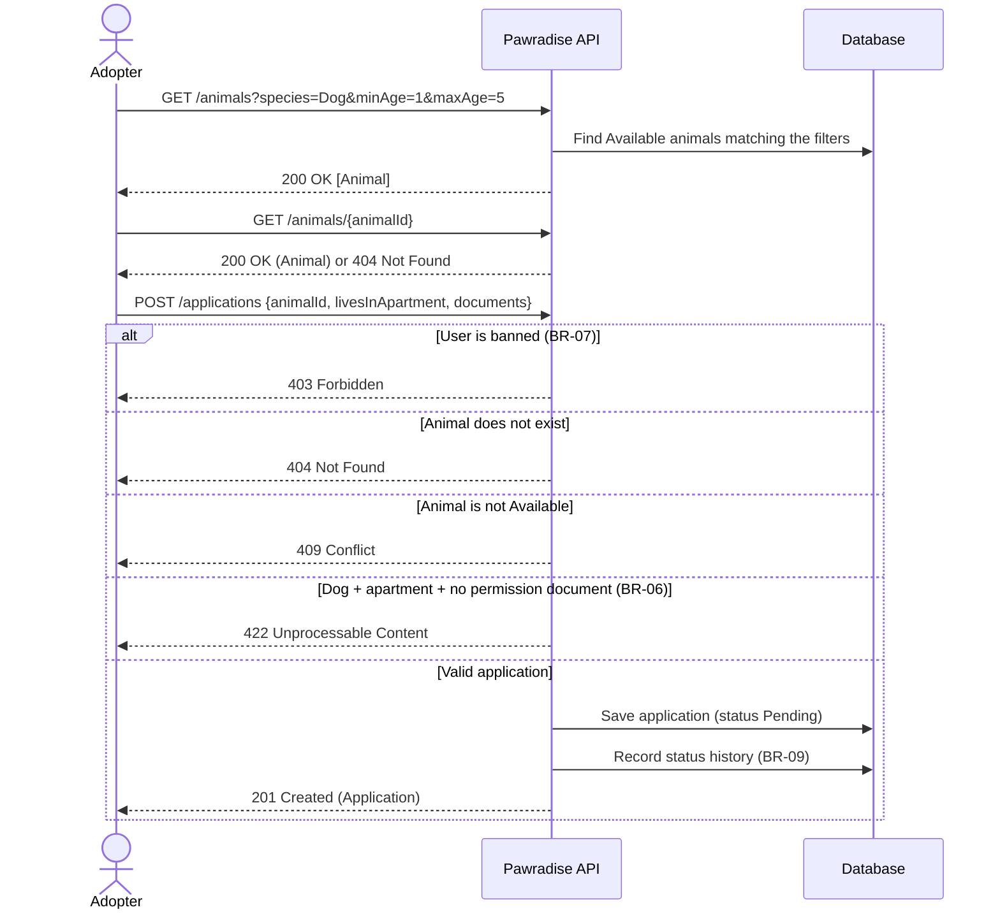
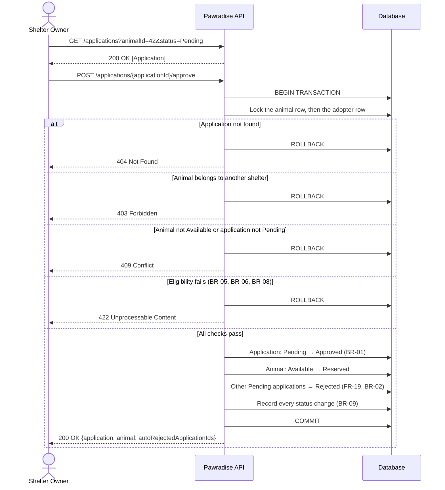
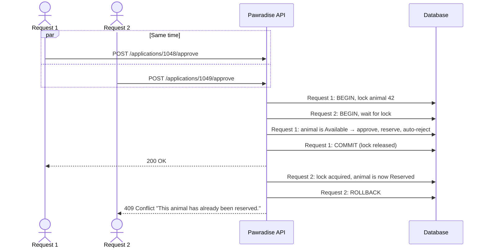
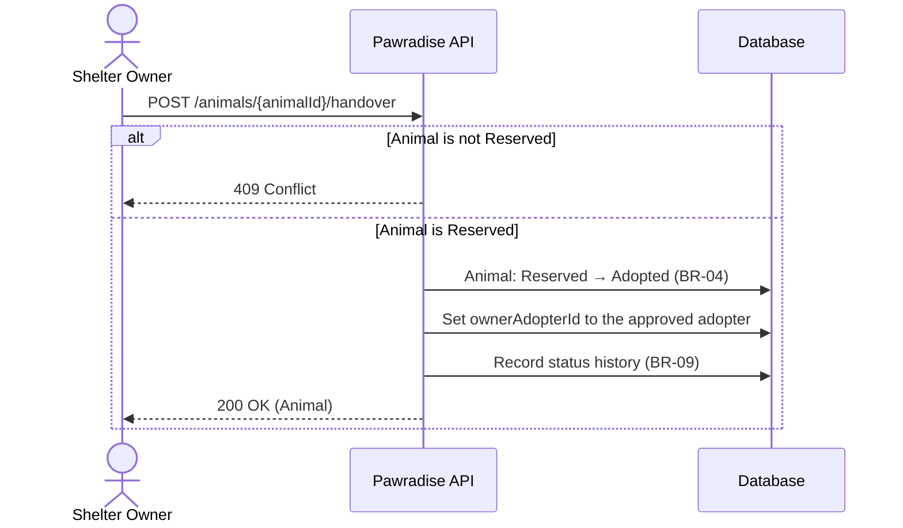
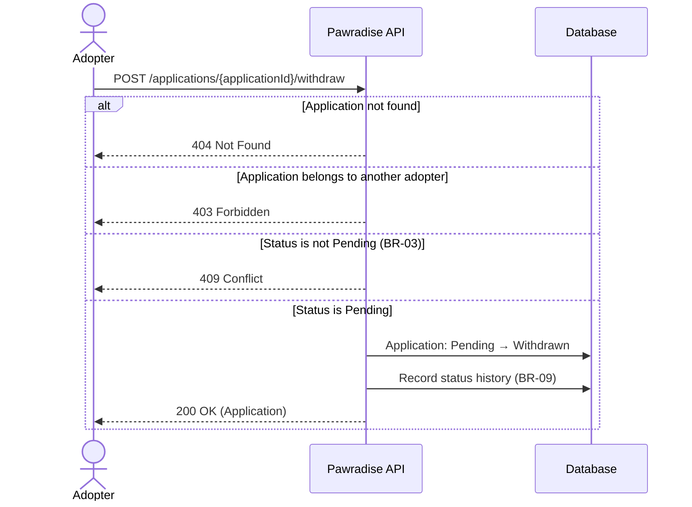
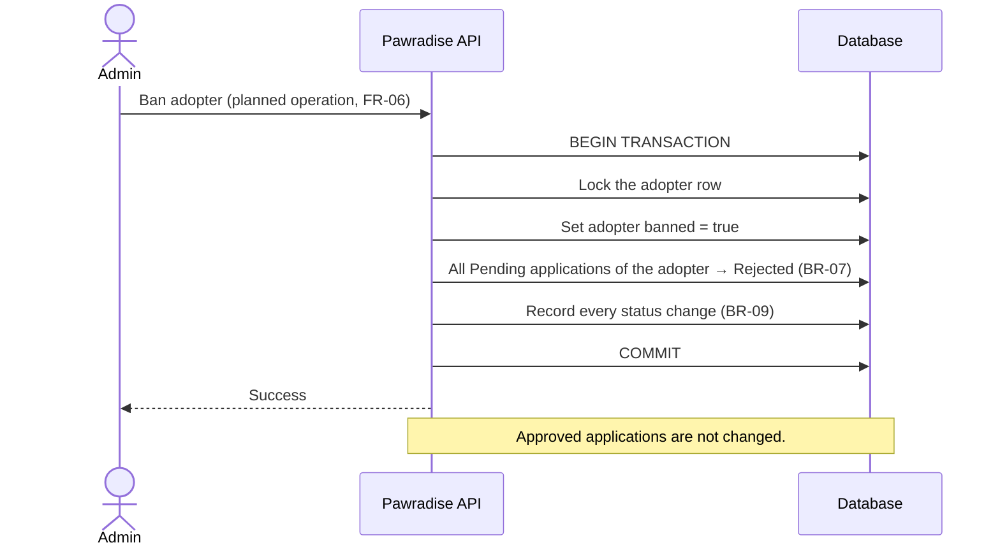
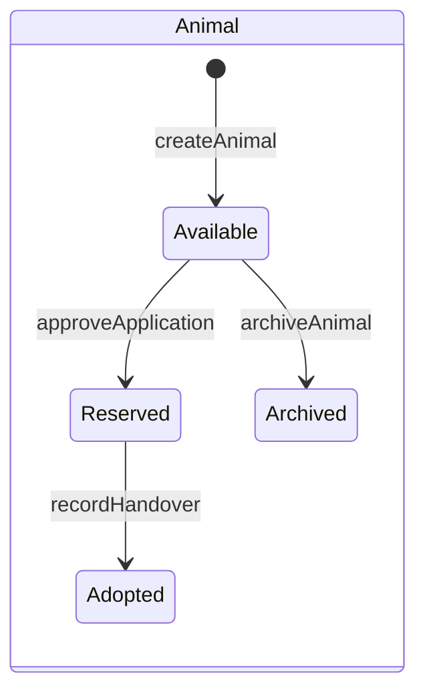
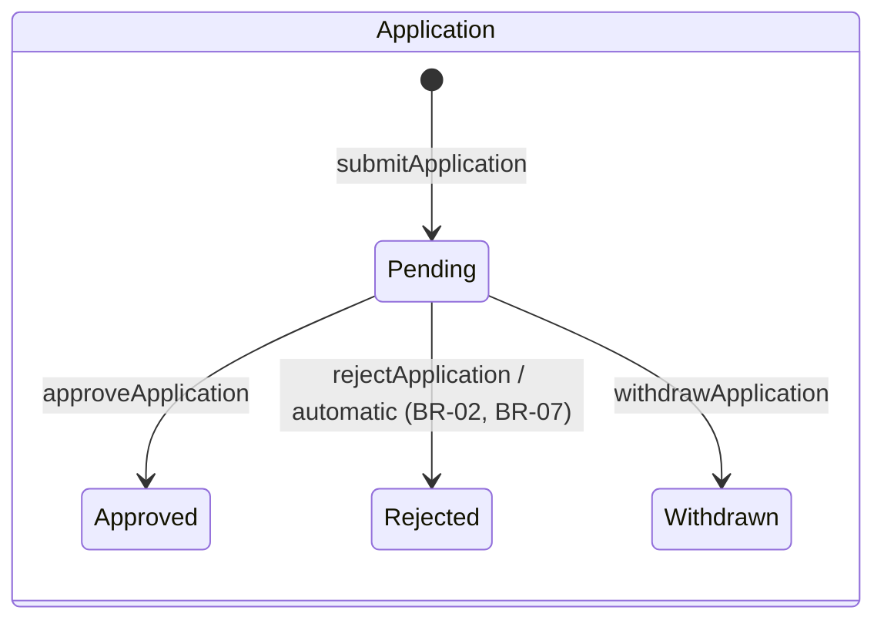

# Pawradise – Main API Flows

| Item | Value |
|------|-------|
| Project | Pawradise – Animal Shelter & Adoption System |
| Sprint | Sprint 1 (November 2026) |
| Document Owner | Software Architect |
| Status | Draft – pending team review |
| API Contract | [`api/openapi.yaml`](../api/openapi.yaml) (version 0.1.0) |

> This document explains how the operations in `api/openapi.yaml` work together in the main user journeys. It does not add, remove, or change any requirement. Requirement IDs refer to the Official Requirements Reference for Sprint 1.

---

## 1. Overview

| # | Flow | Main Actor | Operations | Requirements |
|---|------|-----------|------------|--------------|
| F1 | Registration and login | Adopter, Shelter Owner (registration); all roles (login, logout – Admin accounts are not publicly registered, A-03) | `registerUser`, `loginUser`, `logoutUser` | FR-01, FR-02, NFR-02 |
| F2 | Browse and apply | Adopter | `listAnimals`, `getAnimal`, `submitApplication` | FR-13 – FR-16, BR-06, BR-07 |
| F3 | Approve an application | Shelter Owner | `listApplications`, `approveApplication` | FR-10, FR-11, FR-19, FR-20, BR-01, BR-02, BR-05, BR-06, BR-08, BR-09 |
| F4 | Concurrent approval | Shelter Owner | `approveApplication` | NFR-08, BR-01, Scenario 3 |
| F5 | Record handover | Shelter Owner | `recordHandover` | FR-12, BR-04, BR-09 |
| F6 | Withdraw an application | Adopter | `withdrawApplication` | FR-18, BR-03 |
| F7 | Reject or archive | Shelter Owner, Admin | `rejectApplication`, `archiveAnimal` | FR-05, FR-09, FR-11 |
| F8 | Ban an adopter (planned operation) | Admin | Not yet in OpenAPI 0.1.0 | FR-06, BR-07, BR-09 |

**Common rules for all flows**

- Every operation except `registerUser` and `loginUser` requires a bearer token (`Authorization: Bearer <token>`).
- The server checks the user's role before every operation (FR-02, NFR-03). A wrong role returns **403**.
- Every status change is written to the status history with user ID, previous status, new status, and timestamp (BR-09).
- Every error uses the same body: `{ "status": ..., "error": "...", "message": "..." }`.

---

## 2. F1 – Registration and Login

---

## 3. F2 – Browse and Apply

Multiple adopters can apply for the same animal, and one adopter can apply for several animals (Scenario 1).

---

## 4. F3 – Approve an Application

The approval is the most important operation. All steps run in **one database transaction**, so either all changes are saved or none of them are.

**Eligibility checks (FR-20):**

| Rule | Check | Result if it fails |
|------|-------|--------------------|
| BR-05 | All mandatory documents are present | 422 |
| BR-06 | Dog + apartment → apartment permission document is present | 422 |
| BR-08 | The adopter's animals with status Reserved or Adopted, plus this animal, must not exceed three (team decision, OI-02 closed). Available and Archived animals do not count. | 422 |

> Note: BR-07 (banned users) is enforced when an application is submitted (F2, returns 403). When an adopter is banned, their Pending applications are automatically rejected (F8). An approval attempt for such an application therefore fails with 409, because the application is no longer Pending.

---

## 5. F4 – Concurrent Approval (Scenario 3)

Two approval requests for the same animal arrive at the same time. The row lock on the animal makes the second request wait until the first one finishes.

Only one approval succeeds for the same animal.

**Adoption limit under concurrency (BR-08, Scenario 6).** Locking the animal row is not enough for the adoption limit. If an adopter already has two animals in Reserved or Adopted status and two approvals for two *different* animals of the same adopter run at the same time, each transaction locks a different animal row. Both could count "two animals" and both could succeed, giving the adopter four Reserved or Adopted animals.

Therefore the approval transaction must also serialize approvals **per adopter**, for example by locking the adopter's row (`SELECT ... FOR UPDATE`) before counting the adopter's animals, or by an equivalent concurrency control chosen by the implementation team. Locks should always be taken in the same order (animal first, then adopter) to avoid deadlocks. The second transaction then counts the animals after the first one has committed and returns 422 if the limit is reached.

Implementation notes:

- The adopter's count of animals with status Reserved or Adopted must be read **after** the adopter lock is acquired, from current committed data, not from a value read earlier in the transaction.
- The database isolation level and lock order must actually guarantee this behavior. For example, under snapshot-based isolation a plain `SELECT` may still return an old snapshot, so the count query must be a locking read or run at a level that sees the latest committed data.
- This behavior must be verified with a concurrency integration test (two parallel approvals for different animals of an adopter who already has two animals in Reserved or Adopted status; exactly one must succeed, the other must return 422).

---

## 6. F5 – Record Handover

An approved application does not mean the animal is adopted. The animal stays Reserved until this operation is called (Scenario 5).

---

## 7. F6 – Withdraw an Application

---

## 8. F7 – Reject an Application or Archive a Listing

| Operation | Allowed Transition | Who | Error if not allowed |
|-----------|--------------------|-----|----------------------|
| `POST /applications/{applicationId}/reject` | Pending → Rejected | Shelter Owner (own shelter) | 409 |
| `POST /animals/{animalId}/archive` | Available → Archived | Shelter Owner (own listing) or Admin (FR-05) | 409 |

Both operations record the change in the status history (BR-09).

---

## 9. F8 – Ban an Adopter (Planned Operation)

> The Admin ban and unban operations (FR-06) are **not yet defined** in `api/openapi.yaml` version 0.1.0. This section documents the agreed behavior (team decision on BR-07) so that the future endpoint can be designed consistently. No endpoint path is defined here.

Because the ban locks the same adopter row as the approval transaction (F3, F4), a ban and an approval for the same adopter cannot interleave: either the approval finishes first, or the application is already Rejected and the approval returns 409.

## 10. Status Transitions Summary

