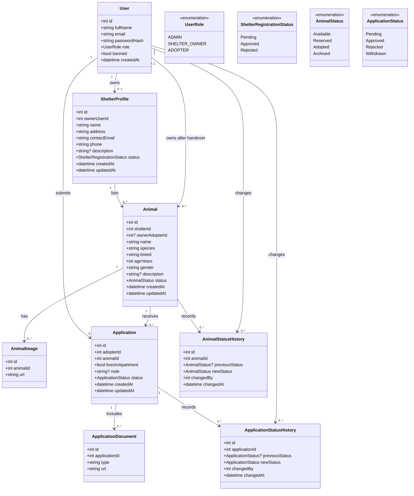

# Pawradise – Architecture Document (C4 Model and UML)

| Item | Value |
|---|---|
| Document | `docs/06-architecture.md` |
| Version | 0.2 (draft) |
| Status | In progress – architecture decisions and domain model ready for review |
| Owner | Işıl Gültekin (Software Architect) |
| Related issue | #53 |
| Related documents | `docs/02-vision-boundary.md`, `api/openapi.yaml`, `docs/07-srs.md`, `docs/08-nfr.md`, `docs/09-ui-ux.md` |

---

## 1. Introduction

### 1.1 Purpose

This document describes the software architecture of Pawradise – Animal Shelter & Adoption System. It records the main architectural decisions, shows the system structure with the C4 model, and describes the domain, data, behaviour and deployment views with UML diagrams.

### 1.2 Scope

The document covers the Sprint 2 architecture baseline. It is aligned with the OpenAPI contract, the functional requirements (FR-01 – FR-21), the non-functional requirements (NFR-01 – NFR-10) and the team decisions K1 – K9.

### 1.3 Technology Stack

| Layer | Technology |
|---|---|
| Frontend | React (served by Nginx) |
| Backend | Python, FastAPI, SQLAlchemy |
| Database | MySQL (InnoDB) |
| Authentication | JWT access tokens, bcrypt password hashing |
| Deployment | Docker Compose (3 containers) |

---

## 2. Architecture Decisions (ADRs)

Each decision records its context, the decision, the alternatives considered and the consequences. All decisions below are accepted by the team (decisions K1, K8, K9).

| ADR | Decision | Related requirements |
|---|---|---|
| ADR-01 | Modular monolith | NFR-08, NFR-10 |
| ADR-02 | Layered backend (Router → Service → Repository) | BR-01 – BR-09 |
| ADR-03 | API-first REST design with OpenAPI | NFR-05 |
| ADR-04 | MySQL InnoDB with pessimistic row locking for approvals | NFR-08, BR-02, BR-08 |
| ADR-05 | JWT authentication and bcrypt password hashing | NFR-02, NFR-03, BR-07 |
| ADR-06 | Docker Compose deployment with Nginx as the single entry point | NFR-10 |
| ADR-07 | Separate status history tables | NFR-09, BR-09 |

### ADR-01: Modular Monolith

**Context.** The system has four functional areas (identity, shelters, animals, adoption applications) that share one data set. The most important operations, such as approving an application or banning an adopter, change data from several areas in a single atomic step (BR-02, BR-07). The team has six members and a ten-week schedule.

**Decision.** The backend is built as one deployable FastAPI application, divided into modules: `auth`, `users` (including admin operations), `shelters`, `animals`, `applications` and `history`. Modules communicate through service-layer function calls, not over the network.

**Alternatives considered.** Microservices (one service per area) were rejected: atomic operations across areas would need distributed transactions, and the operational cost (more containers, network calls, separate databases) is not justified for this team size and scope.

**Consequences.** A single database transaction can cover animals, applications and history. There is one backend container to build and deploy. Module boundaries are kept by package structure and code review, so they are not enforced at runtime.

### ADR-02: Layered Backend (Router → Service → Repository)

**Context.** Business rules (BR-01 – BR-09) must be applied the same way regardless of which endpoint triggers them, and the backend must be testable (unit-test coverage target in Sprint 3).

**Decision.** Each module has three layers:

| Layer | Responsibility | Must not |
|---|---|---|
| Router | HTTP endpoints, request/response validation (Pydantic schemas), authentication and role dependencies, mapping errors to HTTP status codes | Contain business rules or SQL |
| Service | Business rules, eligibility checks, status transitions, transaction boundaries, writing status history | Know about HTTP |
| Repository | Database access with SQLAlchemy (queries, locking reads, inserts, updates) | Contain business rules |

Dependencies point downwards only: Router → Service → Repository.

**Alternatives considered.** Putting logic directly in route handlers was rejected because the same rules (for example, BR-07 auto-rejection) would be duplicated and hard to test.

**Consequences.** Services can be unit-tested without HTTP, and repositories can be replaced with test doubles. Some simple operations pass through layers that add little logic; this is accepted for consistency.

### ADR-03: API-First REST Design with OpenAPI

**Context.** Frontend, backend and UI design are developed in parallel by different team members.

**Decision.** The REST contract in `api/openapi.yaml` is the single source of truth for endpoints, request and response schemas, status codes and the common error body `{status, error, message}`. The contract is changed through pull requests before the implementation changes. Figma screens are mapped to `operationId`s.

**Alternatives considered.** Generating the contract from backend code only was rejected, because frontend and design work would have to wait for the backend.

**Consequences.** Teams can work in parallel against a stable contract. FastAPI also generates its own OpenAPI document at runtime; it must be compared with `api/openapi.yaml` to detect drift between contract and code.

### ADR-04: MySQL InnoDB with Pessimistic Row Locking for Approvals

**Context.** Two shelter-owner requests may try to approve applications at the same time. The system must guarantee that only one application is approved per animal (BR-02, NFR-08) and that an adopter never exceeds three Reserved or Adopted animals (BR-08), even when approvals for different animals of the same adopter run concurrently.

**Decision.** MySQL with the InnoDB engine (transactions, row-level locks, foreign keys) is used. The approval transaction:

1. Locks the animal row with `SELECT … FOR UPDATE`.
2. Locks the adopter's user row with `SELECT … FOR UPDATE`.
3. Re-checks the animal status, the required documents and the BR-08 count **after** the locks are acquired.
4. Updates the application and the animal, auto-rejects competing Pending applications and writes the status history.
5. Commits.

Locks are always taken in the same order (animal, then adopter) to avoid deadlocks. A request that finds the animal no longer Available returns 409; a request that finds the limit reached returns 422.

**Alternatives considered.**
- *Optimistic locking* (version column, retry on conflict): rejected because the adopter-limit check involves several rows and would need more complex retry logic.
- *SERIALIZABLE isolation for all transactions*: rejected because it increases lock contention and deadlocks for ordinary read operations.

**Consequences.** Concurrent approvals for the same animal or the same adopter are serialized; others run in parallel. The behaviour must be verified by the concurrency tests defined in NFR-08.

### ADR-05: JWT Authentication and bcrypt Password Hashing

**Context.** All operations except registration and login require an authenticated user with a role (NFR-03). Passwords must never be stored in plain text (NFR-02).

**Decision.**
- Passwords are hashed with bcrypt (work factor 12). Only the hash is stored; it is never returned by the API.
- Login returns a signed JWT access token (HS256, secret `JWT_SECRET` from the environment) with a lifetime of **30 minutes**. There is no refresh token: after expiry the API returns 401 and the user logs in again (decision K9).
- On every protected request the backend verifies the token and loads the user from the database, so that the current role, the ban flag (BR-07) and, for shelter owners, the shelter registration status (decision K2) are always up to date.
- Logout is handled by the client discarding the token.

**Alternatives considered.**
- *Server-side sessions*: rejected; a stateless token keeps the backend simpler and fits the API-first design.
- *Refresh tokens*: rejected for the first release to keep the design simple (K9).

**Consequences.** A ban or a shelter-status change takes effect on the next request, not at token expiry. Because tokens are not stored on the server, a token copied before logout remains valid until it expires; the short 30-minute lifetime limits this risk.

### ADR-06: Docker Compose Deployment with Nginx as the Single Entry Point

**Context.** The system must start with a single command on the team's machines and in the final demo (NFR-10).

**Decision.** Three containers are defined in one Docker Compose project (decision K8):

| Container | Content | Port |
|---|---|---|
| `frontend` | Nginx serving the React build; forwards `/api/` requests to the backend | 80, the only port published to the host |
| `backend` | FastAPI on Uvicorn | 8000, internal network only (optionally `127.0.0.1:8000` in development for Swagger) |
| `db` | MySQL with the named volume `mysql_data` | 3306, internal network only |

Secrets are read from a `.env` file that is not committed; the repository contains only `.env.example`.

**Alternatives considered.** Publishing the backend port directly to the browser was rejected: it would require CORS configuration and expose the backend.

**Consequences.** Browser and API share one origin, so no CORS is needed. The database and backend are not reachable from outside. Health checks are needed so that services start in the right order.

### ADR-07: Separate Status History Tables

**Context.** Every animal and application status change must be recorded immutably (BR-09, NFR-09). The API returns these records through one schema, `StatusChange` (`entityType`, `entityId`).

**Decision.** Animal and application status changes are stored in two tables, `animal_status_history` and `application_status_history`, each with a foreign key to its animal or application.

**Alternatives considered.** A single polymorphic table (`entityType` + `entityId`) was rejected: `entityId` could refer to either an animal or an application, so the database could not enforce a foreign key.

**Consequences.** The database guarantees that every history record refers to an existing entity. The backend maps rows from both tables to the single `StatusChange` schema. Animals and applications are never hard-deleted, so the foreign keys do not block normal operations.

---

## 3. C4 Level 1 – System Context

_To be completed._

---

## 4. C4 Level 2 – Container Diagram

_To be completed._

---

## 5. C4 Level 3 – Component Diagram (Backend)

_To be completed._

---

## 6. Domain Model

### 6.1 Class Diagram

Fields marked with `?` are optional (nullable).

### 6.2 Entities

| Entity | Description | Related FR |
|---|---|---|
| User | Account of an Admin, Shelter Owner or Adopter. Stores the bcrypt password hash and the ban flag. | FR-01, FR-02, FR-06 |
| ShelterProfile | Shelter information submitted by a Shelter Owner, with its registration status. | FR-03, FR-04, FR-07 |
| Animal | Animal listing of a shelter, with its current status and, after handover, its adopter. | FR-05, FR-08, FR-09, FR-12 – FR-15 |
| AnimalImage | One public image URL of an animal. | FR-08 |
| Application | Adoption application of an adopter for one animal. | FR-10, FR-11, FR-16 – FR-20 |
| ApplicationDocument | One document link (type and URL) submitted with an application. | FR-11, FR-16 |
| AnimalStatusHistory | Immutable record of one animal status change. | FR-21 |
| ApplicationStatusHistory | Immutable record of one application status change. | FR-21 |

### 6.3 Relationships

| Relationship | Multiplicity | Meaning |
|---|---|---|
| User – ShelterProfile | 1 – 0..1 | A Shelter Owner has at most one shelter profile (a second profile returns 409). Admins and Adopters have none. |
| ShelterProfile – Animal | 1 – 0..* | A shelter lists many animals; each animal belongs to one shelter. |
| Animal – AnimalImage | 1 – 0..* | An animal has many image URLs. |
| User – Animal | 0..1 – 0..* | After handover, the adopter becomes the owner of the animal (`ownerAdopterId`). |
| User – Application | 1 – 0..* | An adopter submits many applications. |
| Animal – Application | 1 – 0..* | An animal receives many applications. |
| Application – ApplicationDocument | 1 – 0..* | Documents are submitted with one application and belong only to it. |
| Animal – AnimalStatusHistory | 1 – 0..* | Every animal status change is recorded. |
| Application – ApplicationStatusHistory | 1 – 0..* | Every application status change is recorded. |
| User – status history | 1 – 0..* | `changedBy` refers to the user who made the change. |

### 6.4 Design Notes

1. **Domain model vs. API schemas.** The entities match the OpenAPI schemas `User`, `ShelterProfile`, `Animal`, `Application`, `ApplicationDocument` and `StatusChange`. Request and response schemas such as `NewAnimal`, `LoginRequest` or `ApprovalResult` are data transfer objects and are not stored.
2. **Fields not exposed by the API.** `passwordHash` is stored but never returned in any API response (NFR-02).
3. **Lists stored as rows.** `Animal.imageUrls` and `Application.documents` are lists in the API; in the database each URL or document is one row (`AnimalImage`, `ApplicationDocument`).
4. **Separate status history tables (ADR-07).** Animal and application status changes are stored in two tables, so each record has a foreign key to an existing animal or application. The API still returns a single `StatusChange` schema (`entityType`, `entityId`); the backend maps rows from both tables to it. Animals and applications are never hard-deleted, so the foreign keys do not block normal operations.
5. **Nullable fields.** `ownerAdopterId` is empty until handover. `previousStatus` is empty for the first record of an entity (for example, `null → Pending`).
6. **BR-08 adoption limit.** When an application is approved, the animal becomes Reserved but `ownerAdopterId` stays empty; it is set only at handover (Reserved → Adopted). Therefore the limit of three animals is counted through the adopter's **Approved applications whose animal is Reserved or Adopted**, not through `ownerAdopterId` alone.

---

## 7. Database Schema (ER Diagram)

_To be completed._

---

## 8. Sequence Diagrams

_To be completed._

---

## 9. State Diagrams

_To be completed._

---

## 10. Deployment Diagram

_To be completed._

---

## 11. Traceability (FR → Component)

_To be completed._
