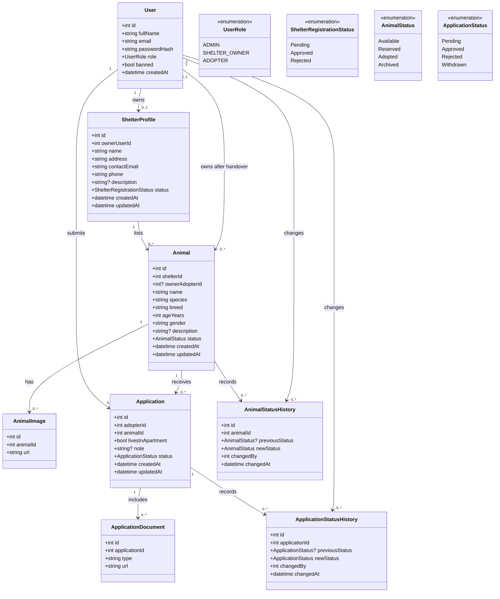

# Pawradise – Architecture Document (C4 Model and UML)

| Item | Value |
|---|---|
| Document | `docs/06-architecture.md` |
| Version | 0.1 (draft) |
| Status | In progress – domain model ready for review |
| Owner | Işıl Gültekin (Software Architect) |
| Related issue | #53 |
| Related documents | `docs/02-vision-boundary.md`, `api/openapi.yaml`, `docs/07-srs.md`, `docs/08-nfr.md`, `docs/09-ui-ux.md` |

---

## 1. Introduction

### 1.1 Purpose

This document describes the software architecture of Pawradise – Animal Shelter & Adoption System. It records the main architectural decisions, shows the system structure with the C4 model, and describes the domain, data, behaviour and deployment views with UML diagrams.

### 1.2 Scope

The document covers the Sprint 2 architecture baseline. It is aligned with the OpenAPI contract, the functional requirements (FR-01 – FR-21), the non-functional requirements (NFR-01 – NFR-10) and the team decisions K1 – K9.

### 1.3 Technology Stack

| Layer | Technology |
|---|---|
| Frontend | React (served by Nginx) |
| Backend | Python, FastAPI, SQLAlchemy |
| Database | MySQL (InnoDB) |
| Authentication | JWT access tokens, bcrypt password hashing |
| Deployment | Docker Compose (3 containers) |

---

## 2. Architecture Decisions (ADRs)

_To be completed._

Planned decisions:

- ADR-01: Modular monolith
- ADR-02: Layered backend (Router → Service → Repository)
- ADR-03: API-first REST design with OpenAPI
- ADR-04: MySQL InnoDB with row-level locking for approvals
- ADR-05: JWT authentication (30-minute access token, no refresh token) and bcrypt password hashing
- ADR-06: Docker Compose deployment with Nginx as the single entry point
- ADR-07: Separate status history tables (see Section 6.4)

---

## 3. C4 Level 1 – System Context

_To be completed._

---

## 4. C4 Level 2 – Container Diagram

_To be completed._

---

## 5. C4 Level 3 – Component Diagram (Backend)

_To be completed._

---

## 6. Domain Model

### 6.1 Class Diagram

Fields marked with `?` are optional (nullable).

### 6.2 Entities

| Entity | Description | Related FR |
|---|---|---|
| User | Account of an Admin, Shelter Owner or Adopter. Stores the bcrypt password hash and the ban flag. | FR-01, FR-02, FR-06 |
| ShelterProfile | Shelter information submitted by a Shelter Owner, with its registration status. | FR-03, FR-04, FR-07 |
| Animal | Animal listing of a shelter, with its current status and, after handover, its adopter. | FR-05, FR-08, FR-09, FR-12 – FR-15 |
| AnimalImage | One public image URL of an animal. | FR-08 |
| Application | Adoption application of an adopter for one animal. | FR-10, FR-11, FR-16 – FR-20 |
| ApplicationDocument | One document link (type and URL) submitted with an application. | FR-11, FR-16 |
| AnimalStatusHistory | Immutable record of one animal status change. | FR-21 |
| ApplicationStatusHistory | Immutable record of one application status change. | FR-21 |

### 6.3 Relationships

| Relationship | Multiplicity | Meaning |
|---|---|---|
| User – ShelterProfile | 1 – 0..1 | A Shelter Owner has at most one shelter profile (a second profile returns 409). Admins and Adopters have none. |
| ShelterProfile – Animal | 1 – 0..* | A shelter lists many animals; each animal belongs to one shelter. |
| Animal – AnimalImage | 1 – 0..* | An animal has many image URLs. |
| User – Animal | 0..1 – 0..* | After handover, the adopter becomes the owner of the animal (`ownerAdopterId`). |
| User – Application | 1 – 0..* | An adopter submits many applications. |
| Animal – Application | 1 – 0..* | An animal receives many applications. |
| Application – ApplicationDocument | 1 – 0..* | Documents are submitted with one application and belong only to it. |
| Animal – AnimalStatusHistory | 1 – 0..* | Every animal status change is recorded. |
| Application – ApplicationStatusHistory | 1 – 0..* | Every application status change is recorded. |
| User – status history | 1 – 0..* | `changedBy` refers to the user who made the change. |

### 6.4 Design Notes

1. **Domain model vs. API schemas.** The entities match the OpenAPI schemas `User`, `ShelterProfile`, `Animal`, `Application`, `ApplicationDocument` and `StatusChange`. Request and response schemas such as `NewAnimal`, `LoginRequest` or `ApprovalResult` are data transfer objects and are not stored.
2. **Fields not exposed by the API.** `passwordHash` is stored but never returned in any API response (NFR-02).
3. **Lists stored as rows.** `Animal.imageUrls` and `Application.documents` are lists in the API; in the database each URL or document is one row (`AnimalImage`, `ApplicationDocument`).
4. **Separate status history tables (ADR-07).** Animal and application status changes are stored in two tables, so each record has a foreign key to an existing animal or application. The API still returns a single `StatusChange` schema (`entityType`, `entityId`); the backend maps rows from both tables to it. Animals and applications are never hard-deleted, so the foreign keys do not block normal operations.
5. **Nullable fields.** `ownerAdopterId` is empty until handover. `previousStatus` is empty for the first record of an entity (for example, `null → Pending`).
6. **BR-08 adoption limit.** When an application is approved, the animal becomes Reserved but `ownerAdopterId` stays empty; it is set only at handover (Reserved → Adopted). Therefore the limit of three animals is counted through the adopter's **Approved applications whose animal is Reserved or Adopted**, not through `ownerAdopterId` alone.

---

## 7. Database Schema (ER Diagram)

_To be completed._

---

## 8. Sequence Diagrams

_To be completed._

---

## 9. State Diagrams

_To be completed._

---

## 10. Deployment Diagram

_To be completed._

---

## 11. Traceability (FR → Component)

_To be completed._
