# Pawradise – Architecture Document (C4 Model and UML)

| Item | Value |
|---|---|
| Document | `docs/06-architecture.md` |
| Version | 1.2 |
| Status | Ready for review |
| Owner | Işıl Gültekin (Software Architect) |
| Related issue | #53 |
| Related documents | `docs/02-vision-boundary.md`, `api/openapi.yaml`, `docs/07-srs.md`, `docs/08-nfr.md`, `docs/09-ui-ux.md` |

---

## 1. Introduction

### 1.1 Purpose

This document describes the software architecture of Pawradise – Animal Shelter & Adoption System. It records the main architectural decisions, shows the system structure with the C4 model, and describes the domain, data, behaviour and deployment views with UML diagrams.

### 1.2 Scope

The document covers the Sprint 2 architecture baseline. It is aligned with the OpenAPI contract, the functional requirements (FR-01 – FR-21), the non-functional requirements (NFR-01 – NFR-10) and the team decisions K1 – K9.

### 1.3 Technology Stack

| Layer | Technology |
|---|---|
| Frontend | React (served by Nginx) |
| Backend | Python, FastAPI, SQLAlchemy |
| Database | MySQL (InnoDB) |
| Authentication | JWT access tokens, bcrypt password hashing |
| Deployment | Docker Compose (3 containers) |

---

## 2. Architecture Decisions (ADRs)

Each decision records its context, the decision, the alternatives considered and the consequences. All decisions below are accepted by the team (decisions K1, K8, K9).

| ADR | Decision | Related requirements |
|---|---|---|
| ADR-01 | Modular monolith | NFR-08, NFR-10 |
| ADR-02 | Layered backend (Router → Service → Repository) | BR-01 – BR-09 |
| ADR-03 | API-first REST design with OpenAPI | NFR-05 |
| ADR-04 | MySQL InnoDB with pessimistic row locking for approvals | NFR-08, BR-02, BR-08 |
| ADR-05 | JWT authentication and bcrypt password hashing | NFR-02, NFR-03, BR-07 |
| ADR-06 | Docker Compose deployment with Nginx as the single entry point | NFR-10 |
| ADR-07 | Separate status history tables | NFR-09, BR-09 |

### ADR-01: Modular Monolith

**Context.** The system has four functional areas (identity, shelters, animals, adoption applications) that share one data set. The most important operations, such as approving an application or banning an adopter, change data from several areas in a single atomic step (BR-02, BR-07). The team has six members and a ten-week schedule.

**Decision.** The backend is built as one deployable FastAPI application, divided into modules: `auth`, `users` (including admin operations), `shelters`, `animals`, `applications` and `history`. Modules communicate through service-layer function calls, not over the network.

**Alternatives considered.** Microservices (one service per area) were rejected: atomic operations across areas would need distributed transactions, and the operational cost (more containers, network calls, separate databases) is not justified for this team size and scope.

**Consequences.** A single database transaction can cover animals, applications and history. There is one backend container to build and deploy. Module boundaries are kept by package structure and code review, so they are not enforced at runtime.

### ADR-02: Layered Backend (Router → Service → Repository)

**Context.** Business rules (BR-01 – BR-09) must be applied the same way regardless of which endpoint triggers them, and the backend must be testable (unit-test coverage target in Sprint 3).

**Decision.** Each module has three layers:

| Layer | Responsibility | Must not |
|---|---|---|
| Router | HTTP endpoints, request/response validation (Pydantic schemas), authentication and role dependencies, mapping errors to HTTP status codes | Contain business rules or SQL |
| Service | Business rules, eligibility checks, status transitions, transaction boundaries, writing status history | Know about HTTP |
| Repository | Database access with SQLAlchemy (queries, locking reads, inserts, updates) | Contain business rules |

Dependencies point downwards only: Router → Service → Repository.

**Alternatives considered.** Putting logic directly in route handlers was rejected because the same rules (for example, BR-07 auto-rejection) would be duplicated and hard to test.

**Consequences.** Services can be unit-tested without HTTP, and repositories can be replaced with test doubles. Some simple operations pass through layers that add little logic; this is accepted for consistency.

### ADR-03: API-First REST Design with OpenAPI

**Context.** Frontend, backend and UI design are developed in parallel by different team members.

**Decision.** The REST contract in `api/openapi.yaml` is the single source of truth for endpoints, request and response schemas, status codes and the common error body `{status, error, message}`. The contract is changed through pull requests before the implementation changes. Figma screens are mapped to `operationId`s.

**Alternatives considered.** Generating the contract from backend code only was rejected, because frontend and design work would have to wait for the backend.

**Consequences.** Teams can work in parallel against a stable contract. FastAPI also generates its own OpenAPI document at runtime; it must be compared with `api/openapi.yaml` to detect drift between contract and code.

### ADR-04: MySQL InnoDB with Pessimistic Row Locking for Approvals

**Context.** Two shelter-owner requests may try to approve applications at the same time. The system must guarantee that only one application is approved per animal (BR-02, NFR-08) and that an adopter never exceeds three Reserved or Adopted animals (BR-08), even when approvals for different animals of the same adopter run concurrently.

**Decision.** MySQL with the InnoDB engine (transactions, row-level locks, foreign keys) is used. The approval transaction:

1. Locks the animal row with `SELECT … FOR UPDATE`.
2. Locks the adopter's user row with `SELECT … FOR UPDATE`.
3. Re-checks the animal status, the required documents and the BR-08 count **after** the locks are acquired.
4. Updates the application and the animal, auto-rejects competing Pending applications and writes the status history.
5. Commits.

Locks are always taken in the same order (animal, then adopter) to avoid deadlocks. A request that finds the animal no longer Available returns 409; a request that finds the limit reached returns 422.

**Alternatives considered.**
- *Optimistic locking* (version column, retry on conflict): rejected because the adopter-limit check involves several rows and would need more complex retry logic.
- *SERIALIZABLE isolation for all transactions*: rejected because it increases lock contention and deadlocks for ordinary read operations.

**Consequences.** Concurrent approvals for the same animal or the same adopter are serialized; others run in parallel. The behaviour must be verified by the concurrency tests defined in NFR-08.

### ADR-05: JWT Authentication and bcrypt Password Hashing

**Context.** All operations except registration and login require an authenticated user with a role (NFR-03). Passwords must never be stored in plain text (NFR-02).

**Decision.**
- Passwords are hashed with bcrypt (work factor 12). Only the hash is stored; it is never returned by the API.
- Login returns a signed JWT access token (HS256, secret `JWT_SECRET` from the environment) with a lifetime of **30 minutes**. There is no refresh token: after expiry the API returns 401 and the user logs in again (decision K9).
- On every protected request the backend verifies the token and loads the user from the database, so that the current role, the ban flag (BR-07) and, for shelter owners, the shelter registration status (decision K2) are always up to date.
- Logout is handled by the client discarding the token.

**Alternatives considered.**
- *Server-side sessions*: rejected; a stateless token keeps the backend simpler and fits the API-first design.
- *Refresh tokens*: rejected for the first release to keep the design simple (K9).

**Consequences.** A ban or a shelter-status change takes effect on the next request, not at token expiry. Because tokens are not stored on the server, a token copied before logout remains valid until it expires; the short 30-minute lifetime limits this risk.

### ADR-06: Docker Compose Deployment with Nginx as the Single Entry Point

**Context.** The system must start with a single command on the team's machines and in the final demo (NFR-10).

**Decision.** Three containers are defined in one Docker Compose project (decision K8):

| Container | Content | Port |
|---|---|---|
| `frontend` | Nginx serving the React build; forwards `/api/` requests to the backend | 80, the only port published to the host |
| `backend` | FastAPI on Uvicorn | 8000, internal network only (optionally `127.0.0.1:8000` in development for Swagger) |
| `db` | MySQL with the named volume `mysql_data` | 3306, internal network only |

Secrets are read from a `.env` file that is not committed; the repository contains only `.env.example`.

**Alternatives considered.** Publishing the backend port directly to the browser was rejected: it would require CORS configuration and expose the backend.

**Consequences.** Browser and API share one origin, so no CORS is needed. The database and backend are not reachable from outside. Health checks are needed so that services start in the right order.

### ADR-07: Separate Status History Tables

**Context.** Every animal and application status change must be recorded immutably (BR-09, NFR-09). The API returns these records through one schema, `StatusChange` (`entityType`, `entityId`).

**Decision.** Animal and application status changes are stored in two tables, `animal_status_history` and `application_status_history`, each with a foreign key to its animal or application.

**Alternatives considered.** A single polymorphic table (`entityType` + `entityId`) was rejected: `entityId` could refer to either an animal or an application, so the database could not enforce a foreign key.

**Consequences.** The database guarantees that every history record refers to an existing entity. The backend maps rows from both tables to the single `StatusChange` schema. Animals and applications are never hard-deleted, so the foreign keys do not block normal operations.

---

## 3. C4 Level 1 – System Context

The context diagram shows Pawradise as a single software system, the people who use it and the external system it depends on. It is consistent with the system context in `docs/02-vision-boundary.md` (Section 6).

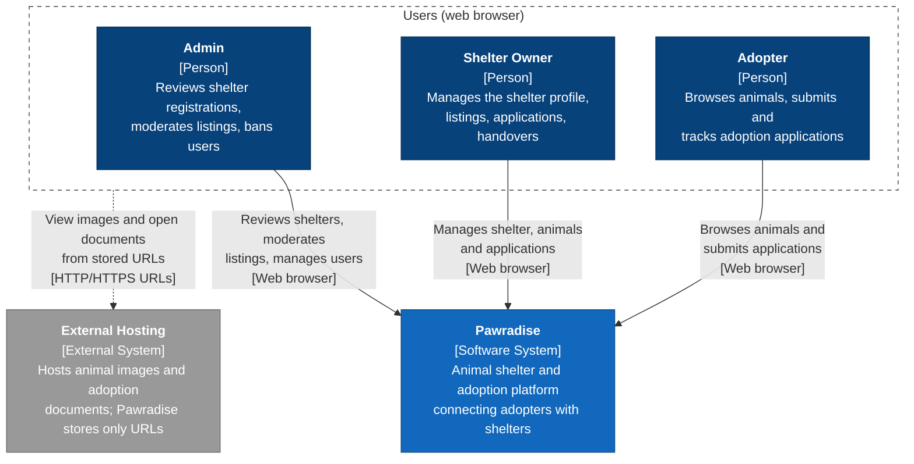

| Element | Type | Responsibility | Related FR |
|---|---|---|---|
| Admin | Person | Reviews shelter registration requests, archives inappropriate listings, bans and unbans users. Admin accounts are seeded, not publicly registered (A-03). | FR-03 – FR-06 |
| Shelter Owner | Person | Submits and maintains the shelter profile; after approval, manages listings, reviews and decides applications, records handovers. | FR-07 – FR-12 |
| Adopter | Person | Browses and filters animals, submits, tracks and withdraws applications. | FR-13 – FR-18 |
| Pawradise | Software system | Enforces all business rules (BR-01 – BR-09) and stores all data, including the URLs of images and documents. | FR-01 – FR-21 |
| External Hosting | External system | Hosts image and document files. Pawradise never uploads, downloads or proxies these files; the user's browser opens the stored URLs directly. | FR-05, FR-08, FR-11, FR-13 – FR-16 |

**Notes.**
- Pawradise has no outgoing integrations: no payment, e-mail, messaging, maps or analytics services (out of scope).
- External Hosting is outside the system's control; an image or document link may become unavailable. The frontend shows a placeholder for broken images.

---

## 4. C4 Level 2 – Container Diagram

The container diagram zooms into Pawradise and shows the separately running parts of the system, the technologies they use and how they communicate (ADR-01, ADR-03, ADR-06).

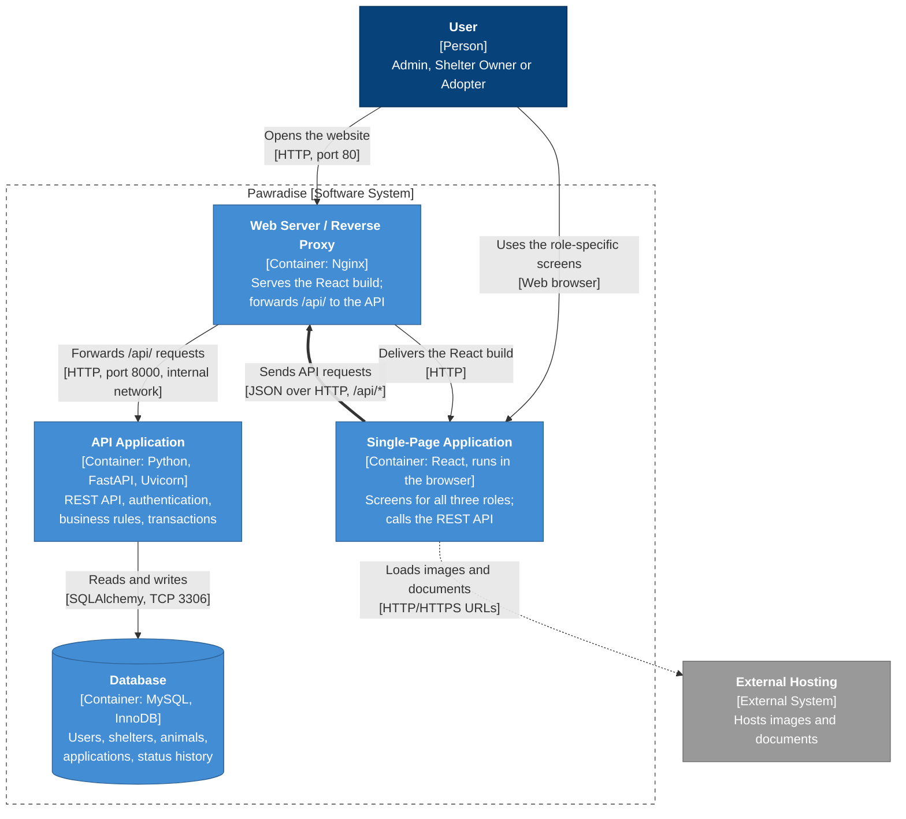

| Container | Technology | Responsibility | Interfaces |
|---|---|---|---|
| Single-Page Application | React | Role-specific screens (see `docs/09-ui-ux.md`); keeps the access token for the session and sends it as `Authorization: Bearer <token>`; redirects to the login screen on 401. Contains no business rules. | Calls the REST API through `/api/*`; loads images and documents from their URLs |
| Web Server / Reverse Proxy | Nginx | Serves the static React build; forwards every `/api/` request to the API Application. The only entry point exposed to the host (port 80). | HTTP on port 80 from the browser; HTTP to the API on the internal network |
| API Application | Python, FastAPI, Uvicorn, SQLAlchemy | Implements the OpenAPI contract: authentication (JWT, bcrypt), role checks, business rules BR-01 – BR-09, transactions and row locking, status history. Internal structure: Section 5. | REST/JSON as defined in `api/openapi.yaml`; SQL to the database |
| Database | MySQL (InnoDB) | Stores all persistent data (Section 6 and Section 7); provides transactions, row-level locks and foreign keys. Data persists in the named volume `mysql_data`. | Accessible only from the API Application on the internal network |

**C4 containers and Docker containers.** In C4, a *container* is any separately running unit, so the React application running in the user's browser is a container of its own. In the deployment (Section 10) there are three Docker containers: `frontend` (Nginx with the React build), `backend` (API Application) and `db` (Database).

**HTTP and HTTPS.** The local and demo deployment serves Pawradise over HTTP on port 80, as defined in the Docker Compose plan. Serving HTTPS would require a TLS certificate on Nginx (port 443); this is out of scope for the current sprints and would not change the other containers.

**Security boundaries.** The browser is an untrusted client; every rule is enforced in the API Application. Only Nginx is reachable from outside; the API and the database are on the internal Docker network (ADR-06).

---

## 5. C4 Level 3 – Component Diagram (Backend)

The component diagram zooms into the API Application. It shows the backend modules (ADR-01) and the three layers inside them (ADR-02). Routers and services are grouped by layer; the Repositories box stands for the repository classes of all modules.

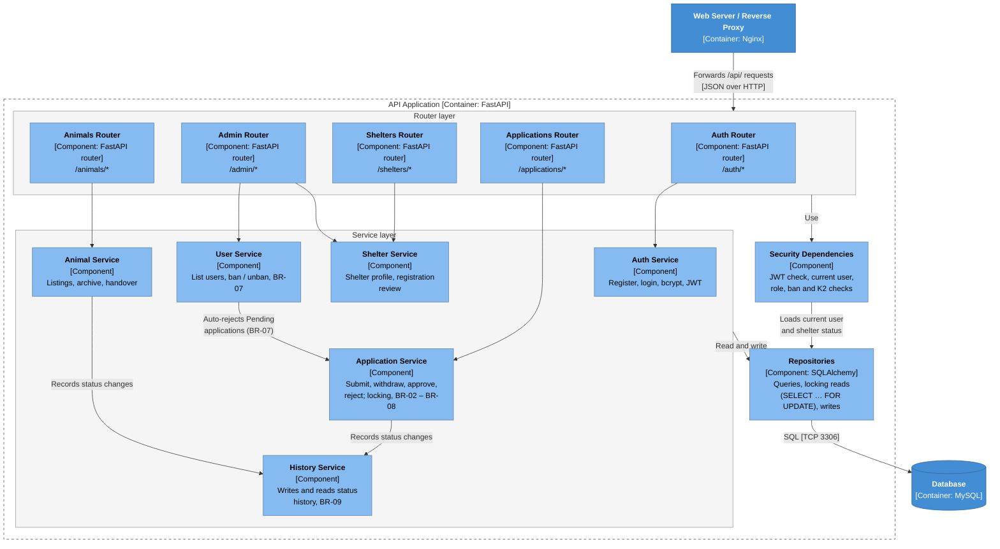

### 5.1 Components

| Component | Layer | Responsibility | OpenAPI operations | FR |
|---|---|---|---|---|
| Auth Router | Router | Registration, login and logout endpoints | `registerUser`, `loginUser`, `logoutUser` | FR-01 |
| Animals Router | Router | Animal listing, detail, create, update, archive, handover and status history endpoints | `listAnimals`, `getAnimal`, `createAnimal`, `updateAnimal`, `archiveAnimal`, `recordHandover`, `getAnimalStatusHistory` | FR-05, FR-08, FR-09, FR-12 – FR-15, FR-21 |
| Applications Router | Router | Application endpoints for adopters and shelter owners | `submitApplication`, `listApplications`, `getApplication`, `withdrawApplication`, `approveApplication`, `rejectApplication` | FR-10, FR-11, FR-16 – FR-20 |
| Shelters Router | Router | Shelter profile endpoints of the current shelter owner | `createShelterProfile`, `getMyShelterProfile`, `updateMyShelterProfile` | FR-07 |
| Admin Router | Router | Shelter registration review and user management endpoints (Admin only) | `listShelterRegistrationRequests`, `approveShelterRegistration`, `rejectShelterRegistration`, `listUsers` (being added in PR #25), `banUser`, `unbanUser` | FR-03, FR-04, FR-06 |
| Security Dependencies | Cross-cutting | Verifies the JWT, loads the current user, checks the role, rejects banned users where required (BR-07) and requires an Approved shelter profile for shelter operations (K2). Returns 401 or 403. | All protected operations | FR-02, NFR-03 |
| Auth Service | Service | Creates users with bcrypt password hashes, verifies credentials, issues 30-minute JWT access tokens | – | FR-01, NFR-02 |
| Animal Service | Service | Creates and updates listings, archives listings (owner or Admin), records handover (Reserved → Adopted, sets `ownerAdopterId`) | – | FR-05, FR-08, FR-09, FR-12 – FR-15 |
| Application Service | Service | Submits and withdraws applications; approves with row locking (ADR-04), document and BR-08 checks and auto-rejection of competing applications; rejects applications | – | FR-10, FR-11, FR-16 – FR-20 |
| Shelter Service | Service | Creates and updates shelter profiles; approves or rejects registration requests | – | FR-03, FR-04, FR-07 |
| User Service | Service | Lists users; bans and unbans users; on ban, asks the Application Service to reject the adopter's Pending applications in the same transaction (BR-07) | – | FR-06 |
| History Service | Service | Writes an immutable status history record for every animal and application status change; maps both history tables to the `StatusChange` schema (ADR-07) | – | FR-21, NFR-09 |
| Repositories | Repository | SQLAlchemy models and queries for all entities, including locking reads (`SELECT … FOR UPDATE`) | – | – |

### 5.2 Rules Between Components

- Routers call only services and security dependencies; they never access repositories directly.
- Services own the transaction boundary. A service that triggers a status change calls the History Service inside the same transaction, so a status change and its history record are committed together.
- Cross-module operations go through services: the User Service calls the Application Service for BR-07, not the application repository.
- A common exception handler converts service errors into the error body `{status, error, message}` with the status codes defined in the OpenAPI contract (400, 401, 403, 404, 409, 422).

---

## 6. Domain Model

### 6.1 Class Diagram

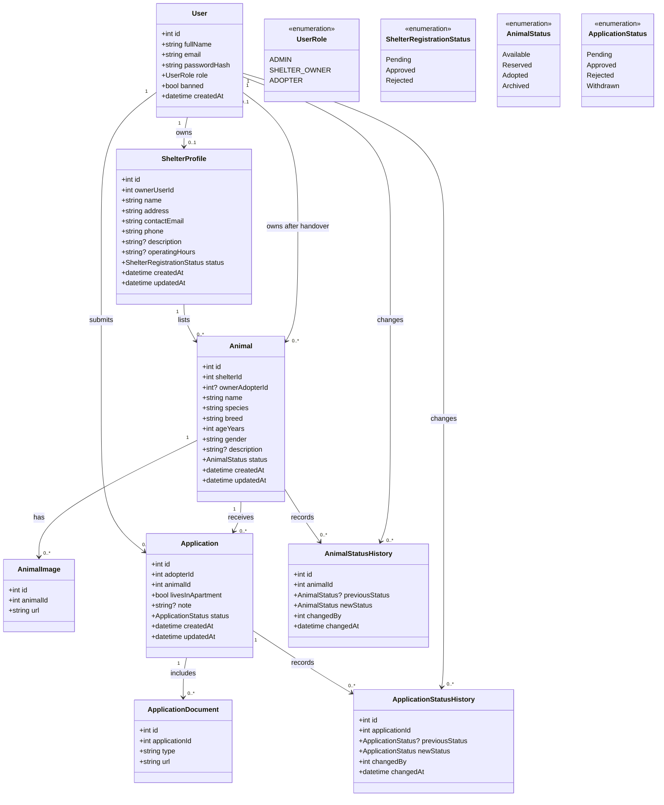

Fields marked with `?` are optional (nullable).

### 6.2 Entities

| Entity | Description | Related FR |
|---|---|---|
| User | Account of an Admin, Shelter Owner or Adopter. Stores the bcrypt password hash and the ban flag. | FR-01, FR-02, FR-06 |
| ShelterProfile | Shelter information submitted by a Shelter Owner (contact details, description, operating hours), with its registration status. | FR-03, FR-04, FR-07 |
| Animal | Animal listing of a shelter, with its current status and, after handover, its adopter. | FR-05, FR-08, FR-09, FR-12 – FR-15 |
| AnimalImage | One public image URL of an animal. | FR-08 |
| Application | Adoption application of an adopter for one animal. | FR-10, FR-11, FR-16 – FR-20 |
| ApplicationDocument | One document link (type and URL) submitted with an application. | FR-11, FR-16, FR-20 |
| AnimalStatusHistory | Immutable record of one animal status change. | FR-21 |
| ApplicationStatusHistory | Immutable record of one application status change. | FR-21 |

### 6.3 Relationships

| Relationship | Multiplicity | Meaning |
|---|---|---|
| User – ShelterProfile | 1 – 0..1 | A Shelter Owner has at most one shelter profile (a second profile returns 409). Admins and Adopters have none. |
| ShelterProfile – Animal | 1 – 0..* | A shelter lists many animals; each animal belongs to one shelter. |
| Animal – AnimalImage | 1 – 0..* | An animal has many image URLs. |
| User – Animal | 0..1 – 0..* | After handover, the adopter becomes the owner of the animal (`ownerAdopterId`). |
| User – Application | 1 – 0..* | An adopter submits many applications. |
| Animal – Application | 1 – 0..* | An animal receives many applications. |
| Application – ApplicationDocument | 1 – 0..* | Documents are submitted with one application and belong only to it. |
| Animal – AnimalStatusHistory | 1 – 0..* | Every animal status change is recorded. |
| Application – ApplicationStatusHistory | 1 – 0..* | Every application status change is recorded. |
| User – status history | 1 – 0..* | `changedBy` refers to the user who made the change. |

### 6.4 Design Notes

1. **Domain model vs. API schemas.** The entities match the OpenAPI schemas `User`, `ShelterProfile`, `Animal`, `Application`, `ApplicationDocument` and `StatusChange`. Request and response schemas such as `NewAnimal`, `LoginRequest` or `ApprovalResult` are data transfer objects and are not stored.
2. **Fields not exposed by the API.** `passwordHash` is stored but never returned in any API response (NFR-02).
3. **Lists stored as rows.** `Animal.imageUrls` and `Application.documents` are lists in the API; in the database each URL or document is one row (`AnimalImage`, `ApplicationDocument`).
4. **Separate status history tables (ADR-07).** Animal and application status changes are stored in two tables, so each record has a foreign key to an existing animal or application. The API still returns a single `StatusChange` schema (`entityType`, `entityId`); the backend maps rows from both tables to it. Animals and applications are never hard-deleted, so the foreign keys do not block normal operations.
5. **Nullable fields.** `ownerAdopterId` is empty until handover. `description`, `operatingHours` and `note` are optional texts. `previousStatus` is empty for the first record of an entity (for example, `null → Pending`).
6. **BR-08 adoption limit.** When an application is approved, the animal becomes Reserved but `ownerAdopterId` stays empty; it is set only at handover (Reserved → Adopted). Therefore the limit of three animals is counted through the adopter's **Approved applications whose animal is Reserved or Adopted**, not through `ownerAdopterId` alone.

---

## 7. Database Schema (ER Diagram)

The database schema implements the domain model (Section 6) in MySQL with the InnoDB engine (ADR-04). Table and column names use `snake_case`; the API uses `camelCase` (for example, `owner_adopter_id` ↔ `ownerAdopterId`). The SQLAlchemy models map between the two.

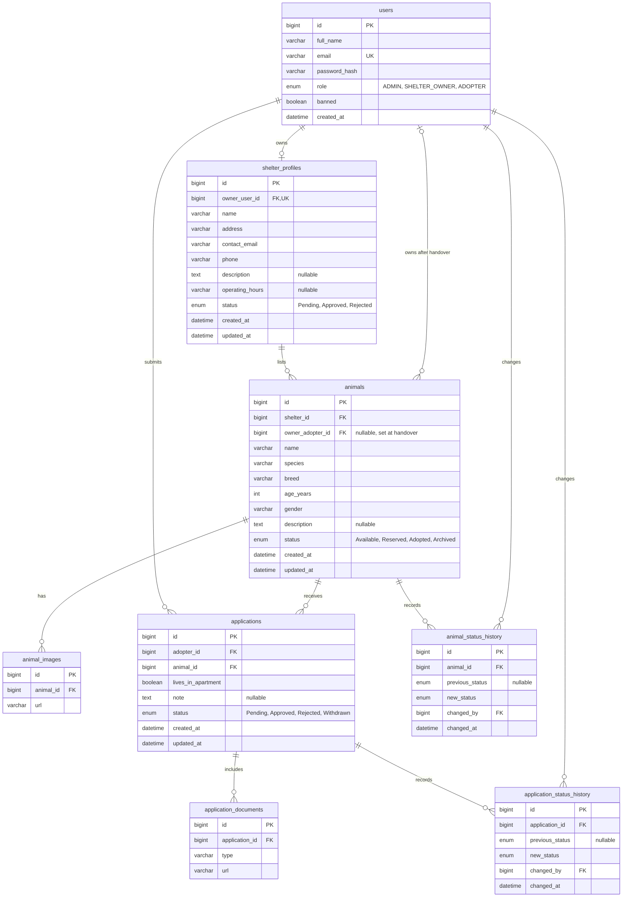

`PK` = primary key, `FK` = foreign key, `UK` = unique key.

### 7.1 Tables

| Table | Entity | Key constraints |
|---|---|---|
| `users` | User | `email` is unique. `role` and `banned` are read on every protected request (ADR-05). |
| `shelter_profiles` | ShelterProfile | `owner_user_id` is unique: one profile per Shelter Owner (a second profile returns 409). |
| `animals` | Animal | `shelter_id` is required. `owner_adopter_id` is nullable and set only at handover (Section 6.4). |
| `animal_images` | AnimalImage | One row per image URL. |
| `applications` | Application | `adopter_id` and `animal_id` are required. |
| `application_documents` | ApplicationDocument | One row per document link. |
| `animal_status_history` | AnimalStatusHistory | Insert-only (ADR-07, BR-09). |
| `application_status_history` | ApplicationStatusHistory | Insert-only (ADR-07, BR-09). |

### 7.2 Design Rules

1. **Identifiers.** All primary keys are `BIGINT AUTO_INCREMENT`, matching the `int64` identifiers in the OpenAPI contract.
2. **Enumerations.** Roles and statuses are stored as MySQL `ENUM` columns with exactly the values of the enumerations in Section 6.1, so invalid values are rejected by the database.
3. **Time.** All `datetime` columns store UTC. `created_at` is set on insert; `updated_at` is set on every update.
4. **No hard deletes.** All foreign keys use `ON DELETE RESTRICT`. Animals are archived, applications change status, and users are banned; no row with history is deleted (BR-09).
5. **Immutable history.** The application only inserts into the two history tables; no update or delete statement is issued for them.
6. **Passwords.** `password_hash` stores the bcrypt hash only (ADR-05, NFR-02).

### 7.3 Indexes

InnoDB creates an index for every primary key, unique key and foreign key. The following additional indexes support the main queries:

| Index | Supports |
|---|---|
| `animals (status, species, age_years)` | Browsing and filtering available animals (FR-13, FR-14, NFR-01) |
| `applications (animal_id, status)` | Listing applications of an animal and auto-rejecting competing Pending applications (FR-10, FR-19, BR-02) |
| `applications (adopter_id, status)` | Listing an adopter's applications and counting Approved applications for BR-08 (FR-17, FR-20) |

---

## 8. Sequence Diagrams

The API-level flows F1 – F8 (registration, browsing and applying, approval, concurrent approval, handover, withdrawal, rejection, ban) are specified in `docs/03-api-flows.md`. This section shows how the components of Section 5 work together inside the API Application for the three flows with the most architectural impact.

### 8.1 Authenticated Request

Every protected request passes through the Security Dependencies before a service is called (ADR-05).

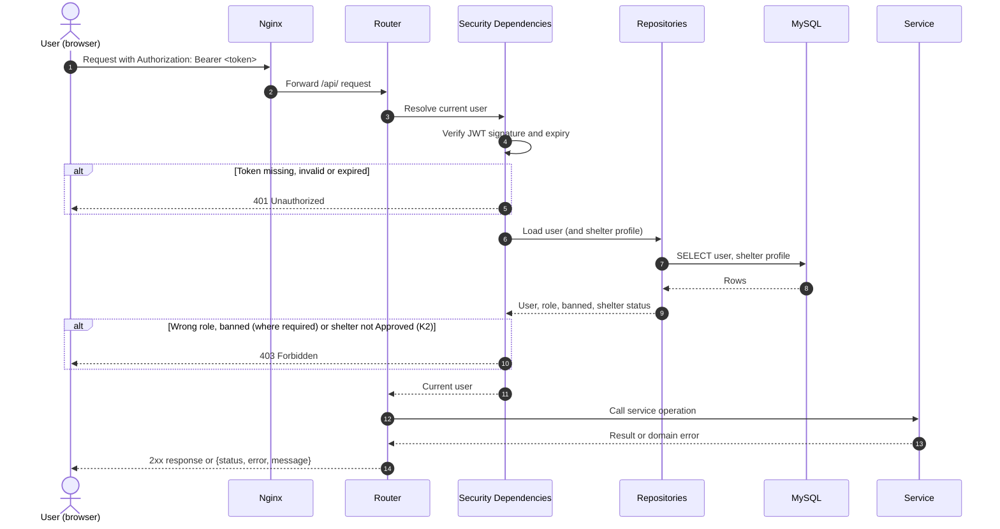

The user is loaded from the database on every request, so a ban or a change of the shelter registration status takes effect immediately, not at token expiry.

### 8.2 Approve an Application

The approval is the most critical transaction of the system (BR-02, BR-05, BR-06, BR-08, BR-09; ADR-04). It corresponds to flows F3 and F4 in `docs/03-api-flows.md`.

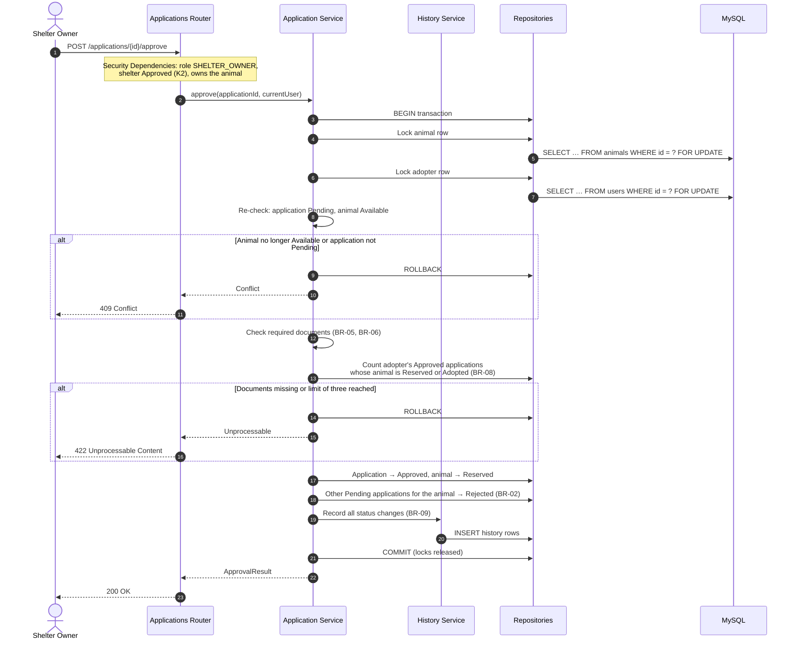

- The animal row is locked first, then the adopter row; all transactions use this order to avoid deadlocks.
- All checks are repeated **after** the locks are acquired. A second request for the same animal waits for the first one and then returns 409; a concurrent approval for another animal of the same adopter waits for the adopter lock and then returns 422 if the limit is reached.
- The status changes and their history records are committed together or not at all.

### 8.3 Ban an Adopter

Banning an adopter and rejecting their Pending applications happen in one transaction (BR-07, flow F8).

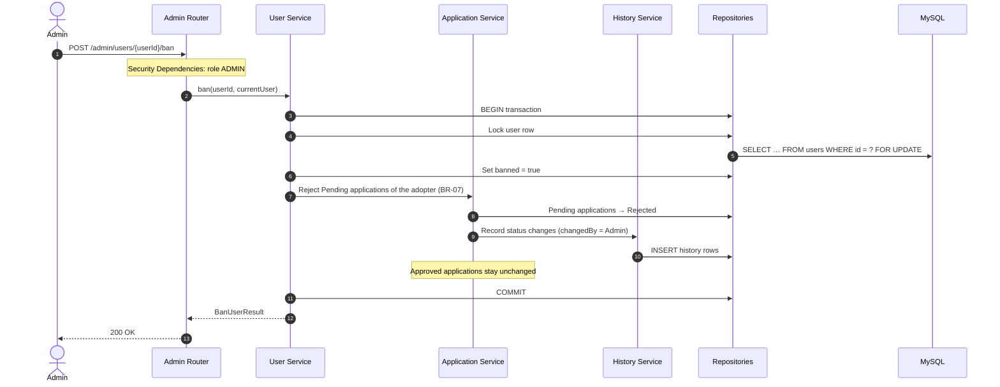

The ban locks the same adopter row as the approval transaction (8.2), so a ban and an approval for the same adopter cannot interleave: either the approval commits first and stays Approved, or the application is already Rejected and the approval returns 409.

---

## 9. State Diagrams

Status values are stored as enumerations (Section 7.2). Every transition is triggered by exactly one API operation or automatic rule and is recorded in the status history (BR-09). A request for a transition that is not shown below returns 409 Conflict.

### 9.1 Animal

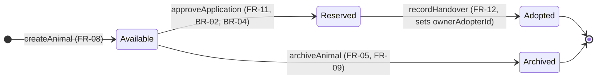

| Transition | Trigger | Condition |
|---|---|---|
| – → Available | `createAnimal` | Shelter profile Approved (K2) |
| Available → Reserved | `approveApplication` | Inside the approval transaction (Section 8.2) |
| Reserved → Adopted | `recordHandover` | Physical handover; sets `ownerAdopterId` (BR-04) |
| Available → Archived | `archiveAnimal` | Owning shelter or Admin (moderation, FR-05) |

Adopted and Archived are final states. Reserved and Adopted animals cannot be archived.

### 9.2 Adoption Application

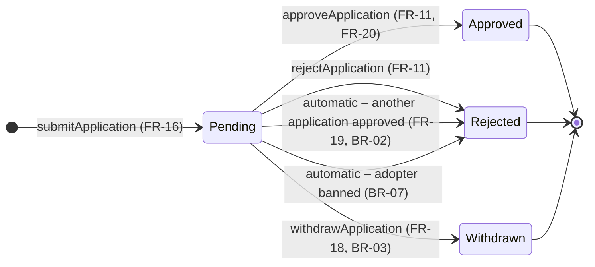

| Transition | Trigger | Condition |
|---|---|---|
| – → Pending | `submitApplication` | Adopter not banned; animal Available; required documents for apartment and dog (BR-06) |
| Pending → Approved | `approveApplication` | Documents complete; adoption limit not reached (BR-05, BR-08) |
| Pending → Rejected | `rejectApplication` | Shelter owner decision |
| Pending → Rejected | automatic | Another application for the same animal is approved (BR-02) |
| Pending → Rejected | automatic | The adopter is banned (BR-07) |
| Pending → Withdrawn | `withdrawApplication` | Only the adopter who submitted it (BR-03) |

Only Pending applications can change status; Approved, Rejected and Withdrawn are final.

### 9.3 Shelter Registration

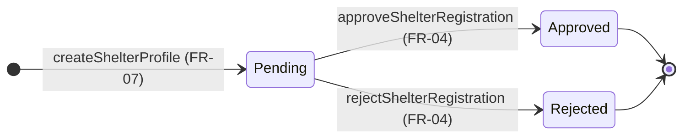

| Transition | Trigger | Condition |
|---|---|---|
| – → Pending | `createShelterProfile` | Shelter Owner without a profile (a second profile returns 409) |
| Pending → Approved | `approveShelterRegistration` | Admin only |
| Pending → Rejected | `rejectShelterRegistration` | Admin only |

Approved and Rejected are final states. A rejected shelter cannot apply again (decision K3). Only an Approved shelter can manage animals and applications (decision K2).

---

## 10. Deployment Diagram

The system is deployed with Docker Compose on a single host (ADR-06, decision K8). The diagram uses UML deployment notation: devices, execution environments and deployed artifacts.

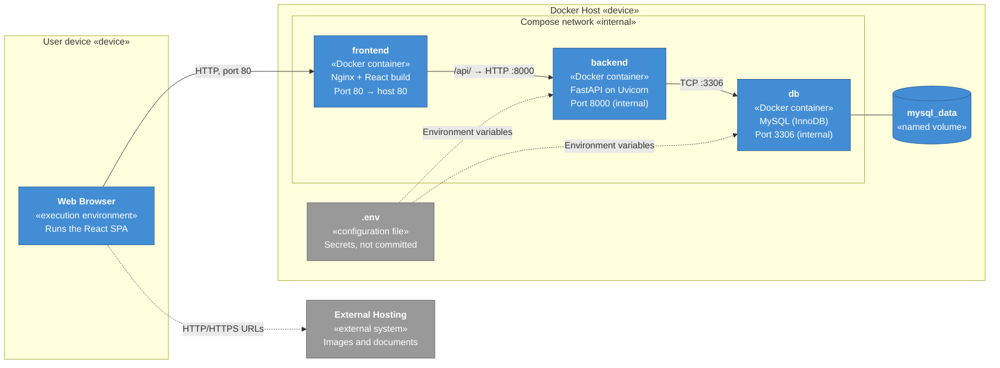

### 10.1 Docker Compose Services

| Service | Content | Ports | Depends on | Configuration |
|---|---|---|---|---|
| `frontend` | Nginx serving the React build; forwards `/api/` to `backend:8000` | `80:80` (the only published port) | `backend` | Nginx configuration |
| `backend` | FastAPI application on Uvicorn | `8000` on the internal network only; optionally `127.0.0.1:8000:8000` in development for Swagger | `db` | `DATABASE_URL`, `JWT_SECRET`, `JWT_ALGORITHM` (HS256), `ACCESS_TOKEN_EXPIRE_MINUTES` (30) |
| `db` | MySQL with InnoDB | `3306` on the internal network only | – | `MYSQL_DATABASE`, `MYSQL_USER`, `MYSQL_PASSWORD`, `MYSQL_ROOT_PASSWORD`; volume `mysql_data` |

### 10.2 Deployment Rules

1. **Single command.** The whole system starts with `docker compose up --build` (NFR-10).
2. **Secrets.** Real values are kept in `.env`, which is listed in `.gitignore`. The repository contains only `.env.example` with placeholder values.
3. **Persistence.** Database files are stored in the named volume `mysql_data`; stopping or rebuilding containers does not delete data.
4. **Start order.** `depends_on` with health checks ensures that the database accepts connections before the backend starts, and the backend is ready before Nginx forwards requests. The health checks are defined in the Docker Compose file (DevOps).
5. **Exposure.** Only port 80 is published. The backend and the database cannot be reached from outside the Docker host (Section 4, security boundaries).
6. **Admin accounts.** Admin users are created by a seed step during deployment, not through public registration (A-03).

---

## 11. Traceability

### 11.1 Functional Requirements → Components

Each functional requirement (official list FR-01 – FR-21, see `docs/02-vision-boundary.md` Section 5 and `docs/07-srs.md`) is implemented by the components below (Section 5) and stored in the listed tables (Section 7).

| FR | Requirement | Router | Service | OpenAPI operations | Tables |
|---|---|---|---|---|---|
| FR-01 | Register, log in and log out | Auth Router | Auth Service | `registerUser`, `loginUser`, `logoutUser` | `users` |
| FR-02 | Role-based access control | All routers | Security Dependencies | All protected operations | `users`, `shelter_profiles` |
| FR-03 | View shelter registration requests | Admin Router | Shelter Service | `listShelterRegistrationRequests` | `shelter_profiles` |
| FR-04 | Approve or reject shelter registration requests | Admin Router | Shelter Service | `approveShelterRegistration`, `rejectShelterRegistration` | `shelter_profiles` |
| FR-05 | Remove or archive inappropriate listings | Animals Router | Animal Service, History Service | `archiveAnimal` | `animals`, `animal_status_history` |
| FR-06 | Ban or unban users (BR-07) | Admin Router | User Service, Application Service, History Service | `listUsers`, `banUser`, `unbanUser` | `users`, `applications`, `application_status_history` |
| FR-07 | Create and update the shelter profile | Shelters Router | Shelter Service | `createShelterProfile`, `getMyShelterProfile`, `updateMyShelterProfile` | `shelter_profiles` |
| FR-08 | Add animal listings with image URLs | Animals Router | Animal Service, History Service | `createAnimal` | `animals`, `animal_images`, `animal_status_history` |
| FR-09 | Update or archive animal listings | Animals Router | Animal Service, History Service | `updateAnimal`, `archiveAnimal` | `animals`, `animal_images`, `animal_status_history` |
| FR-10 | View adoption applications | Applications Router | Application Service | `listApplications`, `getApplication` | `applications`, `application_documents` |
| FR-11 | Approve or reject adoption applications | Applications Router | Application Service, History Service | `approveApplication`, `rejectApplication` | `animals`, `users` (lock), `applications`, both history tables |
| FR-12 | Mark an approved animal as adopted after handover | Animals Router | Animal Service, History Service | `recordHandover` | `animals`, `animal_status_history` |
| FR-13 | View available animals | Animals Router | Animal Service | `listAnimals` | `animals`, `animal_images` |
| FR-14 | Search and filter by species and age | Animals Router | Animal Service | `listAnimals` | `animals` |
| FR-15 | View detailed animal information | Animals Router | Animal Service | `getAnimal` | `animals`, `animal_images` |
| FR-16 | Submit adoption applications with documents | Applications Router | Application Service, History Service | `submitApplication` | `applications`, `application_documents`, `application_status_history` |
| FR-17 | View application statuses and history | Applications Router | Application Service, History Service | `listApplications`, `getApplication` | `applications`, `application_status_history` |
| FR-18 | Withdraw pending applications | Applications Router | Application Service, History Service | `withdrawApplication` | `applications`, `application_status_history` |
| FR-19 | Automatically reject other pending applications when one is approved (BR-02) | Applications Router | Application Service, History Service | `approveApplication` | `applications`, `application_status_history` |
| FR-20 | Prevent approval when eligibility requirements are not met (BR-05, BR-06, BR-08) | Applications Router | Application Service | `approveApplication` | `applications`, `application_documents`, `animals`, `users` (lock) |
| FR-21 | Maintain status history | Animals Router, Applications Router | History Service | `getAnimalStatusHistory`, `getApplication` | both history tables |

Every protected operation also passes through the Security Dependencies (Section 8.1). The K2 gate (Approved shelter profile) applies to FR-08 – FR-12, including the approval rules FR-19 and FR-20.

### 11.2 Non-Functional Requirements → Architecture

| NFR | Quality attribute | Architectural support |
|---|---|---|
| NFR-01 | Performance | Layered backend with direct SQL access through repositories; indexes for browsing and filtering (Section 7.3) |
| NFR-02 | Password security | bcrypt with work factor 12; hash never returned (ADR-05, Section 7.2) |
| NFR-03 | Authentication and authorization | JWT, Security Dependencies with role, ban and K2 checks on every request (ADR-05, Section 8.1) |
| NFR-05 | Consistent error handling | Common error body `{status, error, message}` from one exception handler (ADR-03, Section 5.2) |
| NFR-06, NFR-07 | Browser support, responsive UI | React single-page application served by Nginx; responsive layouts defined in `docs/09-ui-ux.md` (Section 4) |
| NFR-08 | Consistency under concurrency | InnoDB row locking in a fixed order, re-checks after locking (ADR-04, Section 8.2) |
| NFR-09 | Audit trail | Insert-only history tables with foreign keys, written in the same transaction (ADR-07, Section 7.2) |
| NFR-10 | Deployability | Docker Compose, single command, Nginx as the single entry point (ADR-06, Section 10) |

The full list of NFRs, their measurable targets and verification methods is specified in `docs/08-nfr.md`.

### 11.3 Business Rules → Components

| Rule | Enforced in |
|---|---|
| BR-01 | Application Service (multiple applications allowed) |
| BR-02 | Application Service – approval transaction (Section 8.2) |
| BR-03 | Application Service – withdraw |
| BR-04 | Application Service (Reserved) and Animal Service (Adopted at handover) |
| BR-05, BR-06 | Application Service – submit and approve |
| BR-07 | Security Dependencies (banned users) and User Service → Application Service (Section 8.3) |
| BR-08 | Application Service – count after adopter lock (Sections 6.4, 8.2) |
| BR-09 | History Service; insert-only history tables (ADR-07) |
